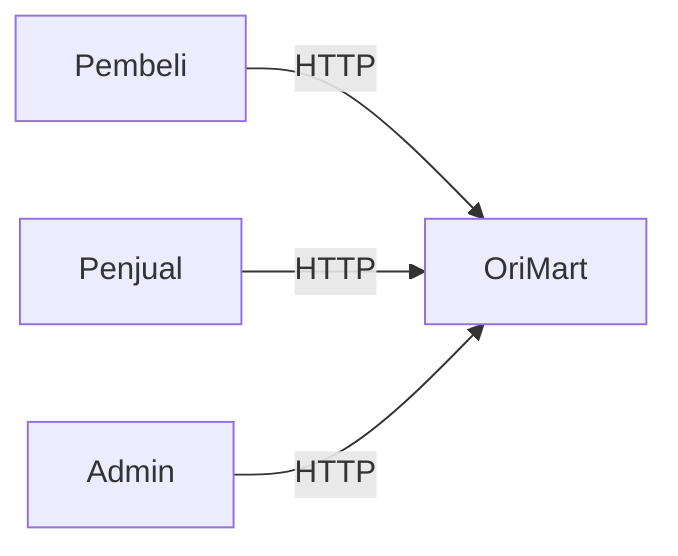
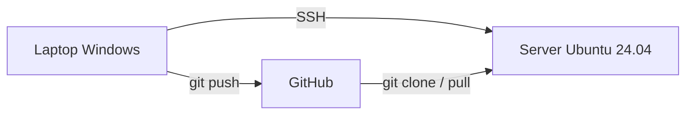
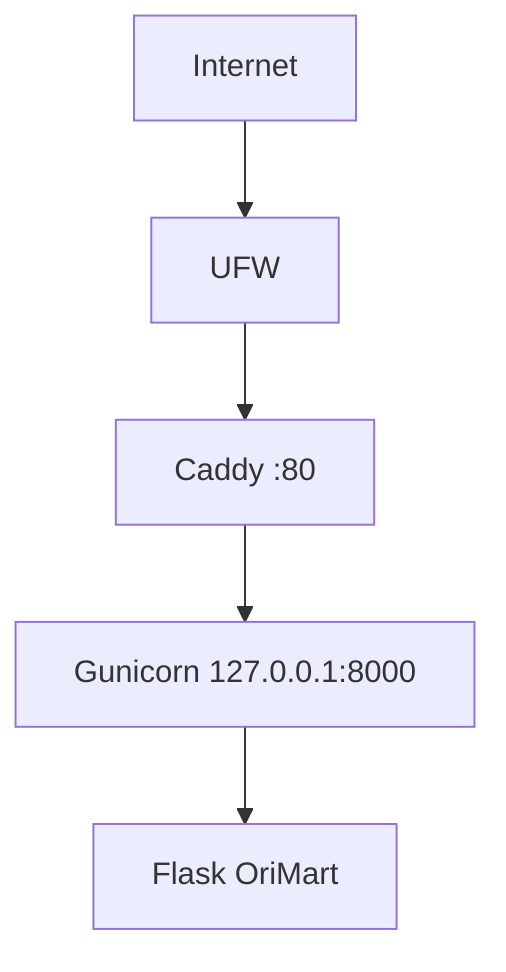
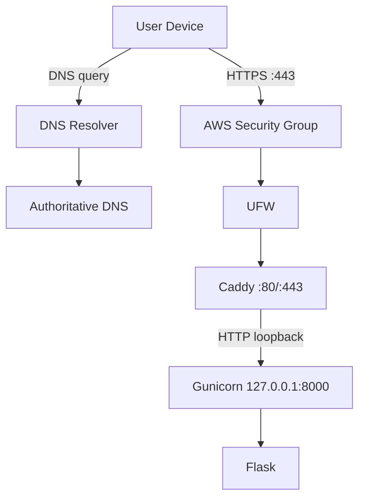

# Architecture v0.1 - OriMart

## Context View

Pada M03 hanya halaman publik dan health endpoint yang tersedia. Peran
penjual dan admin direncanakan pada milestone berikutnya.

## Client - Repository - Server

## Deployment View (di dalam server)

## Komponen

| Komponen | Fungsi | Listen |
|---|---|---|
| UFW | Firewall host, hanya izinkan port yang diperlukan | - |
| Caddy | Reverse proxy, satu-satunya pintu masuk publik | :80 |
| Gunicorn | Application server (1 worker) | 127.0.0.1:8000 |
| Flask | Aplikasi web OriMart | via Gunicorn |
| systemd | Menjalankan Gunicorn sebagai service dan restart otomatis | - |

## Keputusan Desain

- Gunicorn hanya listen pada loopback agar backend tidak terekspos
  langsung ke internet.
- Semua request publik masuk melalui Caddy, sehingga kebijakan HTTPS,
  header, dan routing nanti diatur di satu tempat.
- Hanya 1 worker Gunicorn karena RAM server hanya 1 GB.
- Akses administrasi menggunakan SSH key dengan user non-root.

## Batasan Saat Ini

- Masih HTTP (HTTPS pada M04)
- Belum ada database (M05)
- Belum menggunakan container (M06)
- Deployment masih manual

Keputusan teknis lengkap ada di docs/adr/0001-initial-architecture.md.

## Deployment View v0.2 (M04)

### Public DNS
`<DOMAIN> A 3.106.220.4` (AAAA tidak dibuat; tidak ada IPv6 global)

### Public Ports
- 22/tcp: SSH administration
- 80/tcp: HTTP redirect / ACME challenge
- 443/tcp: HTTPS

### Private Host Ports
- 127.0.0.1:8000: Gunicorn
- 127.0.0.1:2019: Caddy admin API

### TLS
Dikelola otomatis oleh Caddy lewat CA publik (ACME). TLS berakhir di Caddy,
lalu diteruskan ke Gunicorn lewat loopback.

### Status
Menunggu domain/subdomain; nilai `<DOMAIN>` diisi setelah tersedia.
